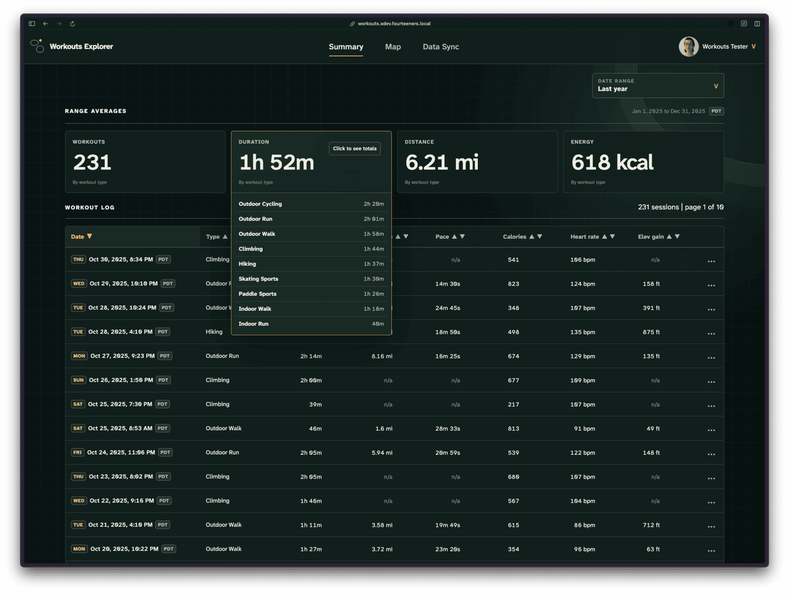
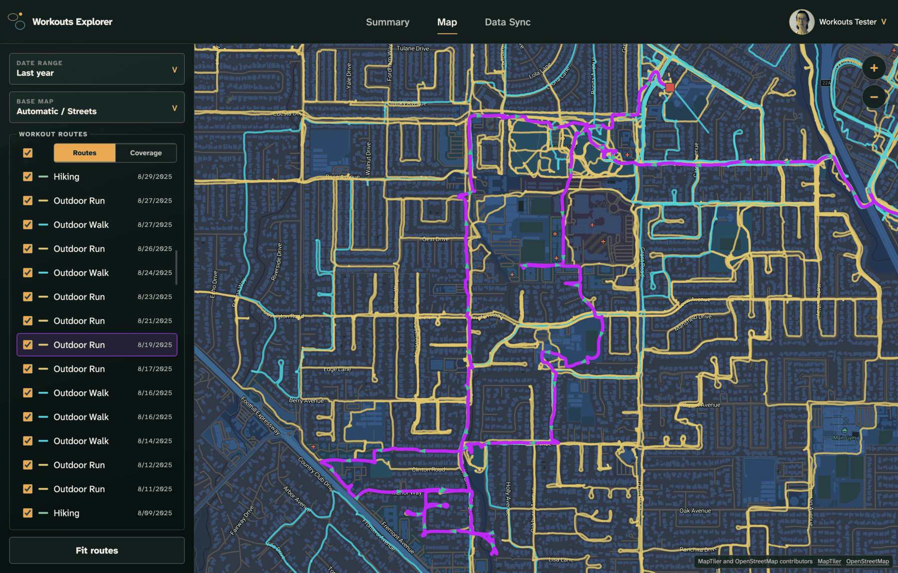
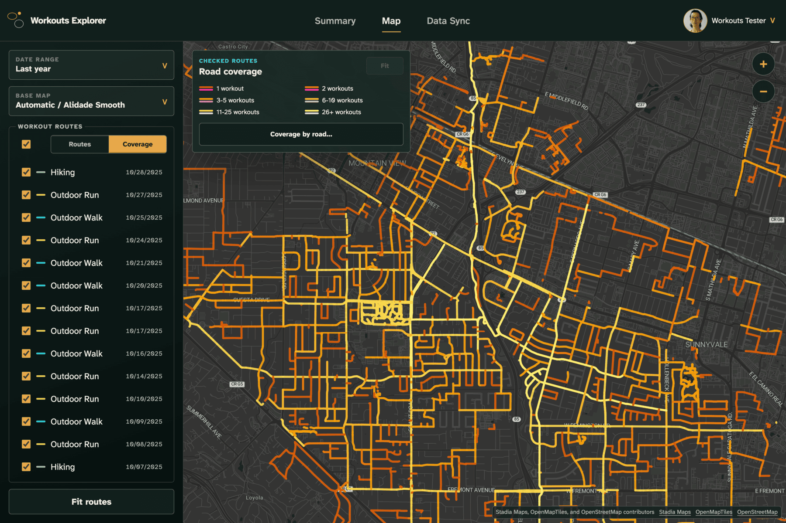
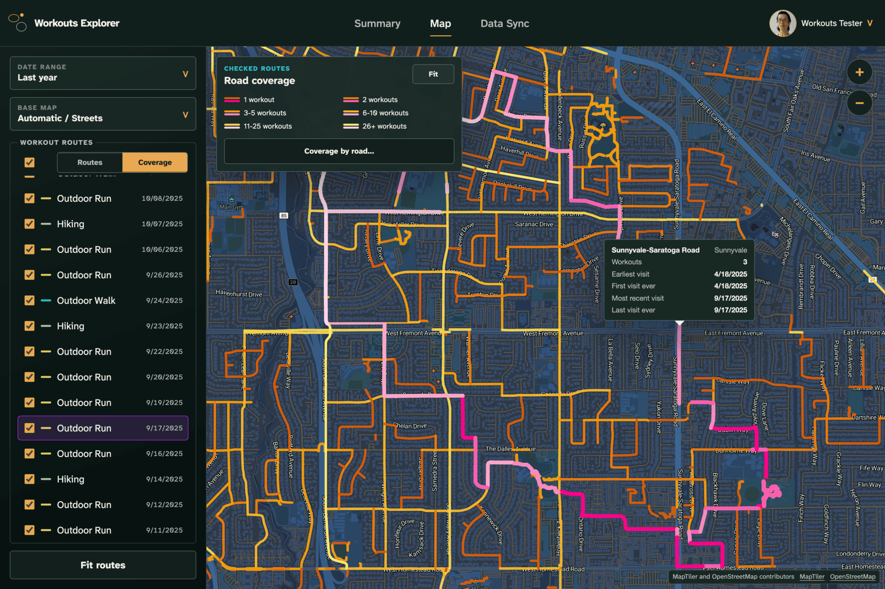
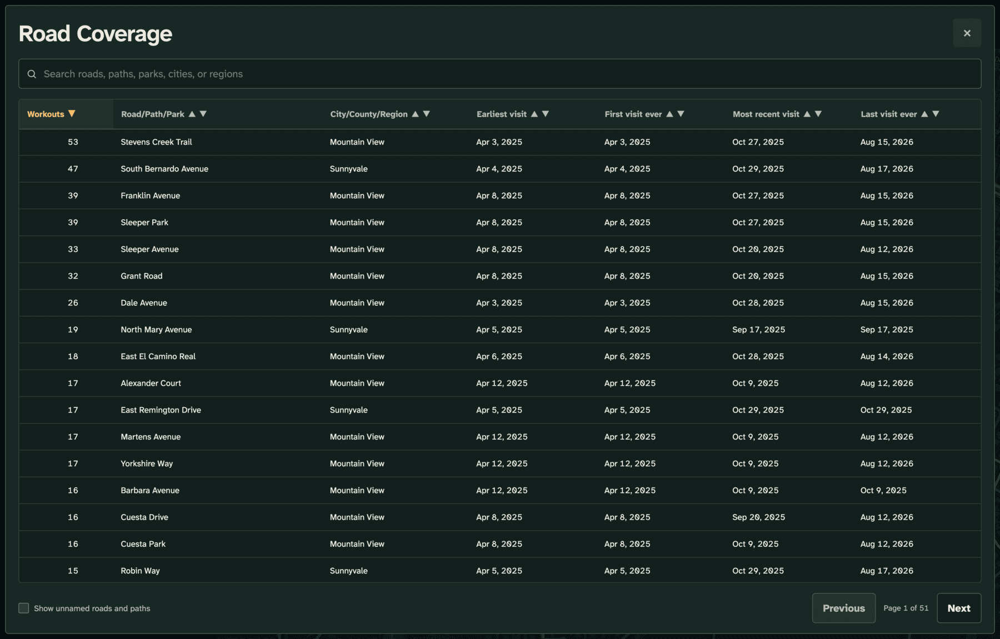

# Workouts Explorer

Workouts Explorer is a web app for exploring recorded fitness activities
through workout summaries, GPS routes, and interactive maps. It helps you
see where you have exercised, understand how your activity changes over
time, discover which roads and paths you visit most often, and identify
nearby places you have yet to explore.

The app is intended for anyone who records fitness activities, although
the initial implementation supports only Apple Watch workouts exported
from Apple Fitness.

The app currently supports secure invited accounts, profile preferences,
and local or network Health Auto Export imports. Imported workouts appear
in a responsive summary with consistent details while repeat imports avoid
duplicates.

Contributor setup, database verification, and packaging guidance are in
[CONTRIBUTING.md](CONTRIBUTING.md).

## Development Progress

| Completed | Milestone | Features |
|:--:|:--:|---|
| ✅ | 1  | Working browser experience; clear unavailable screen during service interruptions; no workout features yet |
| ✅ | 2  | Invitation-only registration; secure sign-in and password recovery; profiles, preferences, and themes |
| ✅ | 3  | Local and network file imports; consistent workout summaries; responsive workout list without duplicate imports |
| ✅ | 4  | Manual and scheduled syncing; progress, cancellation, and retry controls; warnings when no new data arrives |
| ✅ | 5  | Import history; route and point downloads; safe individual workout and date-range deletions |
| ✅ | 6  | Interactive workout routes; date and workout filters; desktop and mobile map controls |
| ✅ | 7  | Visited road and trail coverage; distinct workout counts; sortable path coverage table |
| 🔳 | 8  | Private iCloud setup; remote workout imports; clear prompts when access expires |
| 🔳 | 9  | User and invitation management; announcements; account deletion; OSM administration; operational monitoring and recovery guidance |
| 🔳 | 10 | Tablet-focused UI/UX for iPad-sized devices and larger; touch, orientation, keyboard, zoom, and accessibility; no iPhone-sized development |
| 🔳 | 11 | Typical/stress and large-history benchmarks; mixed-workload responsiveness; failure recovery; functional verification and release readiness |
| 🔳 | 12 | Production deployment; measured scaling and resource limits; least-privilege credentials; network/TLS/security hardening; production recovery validation |
